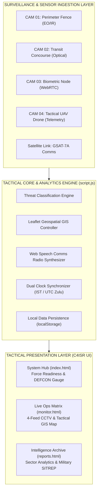

<div align="center">

# 🇮🇳 NSG C4ISR Tactical Command & Control System
### *National Security Guard // Joint Operations Command Core (JOCC)*
**Motto:** *"सर्वत्र सर्वोत्तम सुरक्षा"* *(Omnipresent Omnipotent Security)*  
**Primary Garrison:** Manesar, Gurugram, National Capital Region (NCR), India

[](#)
[](#)
[](#)
[](#)
[](#)

<p align="center">
  <b>A real-time, military-grade Command, Control, Communications, Computers, Intelligence, Surveillance, and Reconnaissance (C4ISR) operations dashboard prototype engineered for counter-terrorism surveillance, quick-reaction deployment, and multi-sensor geospatial threat management.</b>
</p>

[System Overview](#-system-overview) •
[Operational Architecture](#-operational-architecture) •
[Core Modules](#-core-operational-modules) •
[Geospatial Intelligence](#-nsg-regional-operational-hubs) •
[Technical Specifications](#-technical-stack--specifications) •
[Deployment Guide](#-deployment--getting-started) •
[Operator Controls](#-operator-controls--incident-simulation)

---

</div>

## 📌 System Overview

The **NSG C4ISR Tactical Command & Control System** models a state-of-the-art defense operations center for India's elite **National Security Guard (NSG)** under the Ministry of Home Affairs. Operating on a 24/7 high-readiness posture, the system integrates electro-optical/infrared (EO/IR) surveillance, autonomous UAV drone feeds, real-time biometric profiling, encrypted satellite communications (GSAT-7A), and nationwide geospatial command across all six permanent NSG regional deployment hubs.

### Strategic Operational Capabilities
- **C4ISR Unified Defense Dashboard:** Consolidated multi-node telemetry replacing disparate feeds with a standardized tactical interface.
- **Tri-Spectrum Video Reconnaissance:** Instant sensor filtering switching between Optical HD, Generation-3 Night Vision (NVG), and Forward-Looking Infrared (FLIR) thermal thermography.
- **Nationwide Geospatial Deployment Mapping:** High-resolution interactive Leaflet-powered GIS tracking garrisons, quick-reaction cordons, and regional strike zones.
- **Automated Incident Logging & Intelligence Generation:** Dynamic threat telemetry classification feeding into military-standard **SITREP (Situation Report)** document generation ready for operational export.

---

## 🏗️ Operational Architecture

The system utilizes an event-driven telemetry pipeline designed for low-latency browser execution with zero external heavyweight dependencies:



---

## ⚡ Core Operational Modules

### 1. 🎛️ System Command Hub (`index.html`)
The strategic command nerve center providing instantaneous national defense readiness posture:
- **National Threat Advisory Gauge:** Dynamic circular vector dial reflecting real-time threat conditions:
  - `CONDITION: GREEN` (DEFCON 4 — Normal Peacetime Watch)
  - `CONDITION: AMBER` (DEFCON 3 — Elevated Caution / Guarded)
  - `CONDITION: RED` (DEFCON 2 — High Threat / Lockdown Initiated)
- **Special Action Groups (SAG) Telemetry:**
  - **51 SAG (Counter-Terrorism Task Force):** Primary tactical assault group for counter-terrorist interventions.
  - **52 SAG (Anti-Hijack Unit):** Specialist airborne and aircraft intervention unit.
- **Critical Infrastructure Readouts:** GSAT-7A military satellite uplink status, 142/142 perimeter fence sensors operational integrity (99.98%), and 24-hour incident accumulation counts.
- **Dual Military Clocks:** Real-time synchronized digital display of **Indian Standard Time (IST: UTC+5:30)** and **NATO Zulu Time (UTC Date-Time Group: `DDHHMMZ MMM YY`)**.

---

### 2. 📡 Live Tactical Surveillance (`monitor.html`)
The operational matrix coordinating real-time camera reconnaissance, tactical GIS mapping, and incident dispatch:
- **4-Channel Multi-Sensor Surveillance Grid:**
  - **CAM 01 (Exterior Perimeter Cordon):** High-definition perimeter surveillance with target tracking bounding boxes.
  - **CAM 02 (Secure Concourse / Transit Hub):** Continuous lobby and vehicle transit monitoring with automated movement counters.
  - **CAM 03 (Biometric Facial Verification):** Local optical sensor (Webcam/WebRTC integration) running facial identification scans.
  - **CAM 04 (Tactical Drone UAV Recon):** Synthetic aerial reconnaissance viewport complete with HUD crosshair reticle, flight telemetry (Altitude: 140m, Battery: 84%, Bearing: 312° NW), target confidence grading, and threat posture assessment.
- **Tri-Spectrum Video Filter Switcher:**
  - `OPT` — True-color optical visual spectrum.
  - `NVG` — Night Vision Green phosphor intensification with high contrast.
  - `FLIR` — Forward-Looking Infrared (thermal inversion with high-visibility heat signatures).
- **Interactive Geospatial Tactical Map:**
  - Integrated Leaflet.js engine rendered in dark tactical cartography.
  - Interactive radar-style pulse markers for all six Indian regional hubs.
  - Manesar Garrison 8-kilometer security cordon boundary ring.
  - Fast-action toolbar buttons (`ALL HUBS`, `MANESAR HQ`, `MUMBAI`, `KOLKATA`, `CHENNAI`, `HYDERABAD`) with smooth geographic camera transitions.
- **Live Threat Stream & Chronological Timeline:** Real-time streaming incident log cards with color-coded severity classifications (Critical Crimson, Elevated Amber, Routine Blue).
- **Emergency Lockdown Protocol:** Interactive modal overlay with synthesized military audio dispatch (*"Critical alert. Perimeter breach verified..."*) and manual operator override capability.

---

### 3. 📊 Intelligence Archive & SITREP (`reports.html`)
Post-action intelligence retrieval, predictive analysis, and formal defense documentation:
- **Operational KPI Telemetry:** Total surveillance entries logged, critical escalations count, elevated movement advisories, and overall force readiness index (98.4%).
- **Sector Distribution Graph:** Dynamic HTML5 Canvas dual-bar analytics visualization comparing incident frequency across regional sectors (NCR HQ, Mumbai, Kolkata, Chennai, Hyderabad, Gujarat).
- **Standardized Military SITREP (Situation Report) Generator:**
  - **Document Classification:** `RESTRICTED // FOR OFFICIAL USE ONLY (FOUO)`
  - **Standard Military Date-Time Group (DTG):** Automatically generated from UTC Zulu clock (e.g., `220930Z NOV 26`).
  - **Reporting Unit & Posture:** 51 SAG / NSG Joint Task Force HQ disposition.
  - **1-Click Print & PDF Export:** Dedicated CSS print styles formatting the SITREP cleanly for official printouts or PDF archival.
- **Historical Decrypted Event Log Table:** Complete operational audit trail featuring timestamp, sector, incident description, severity badge, and action disposition, equipped with interactive filters (`ALL`, `CRITICAL ONLY`, `ELEVATED ONLY`).

---

## 🗺️ NSG Regional Operational Hubs

The National Security Guard maintains strategically positioned hubs across India to ensure rapid deployment anywhere in the subcontinent within designated response windows:

| Regional Hub | Location & Jurisdiction | Coordinates | Deployment Role | Readiness Status |
| :--- | :--- | :--- | :--- | :--- |
| **Manesar Garrison HQ** | Gurugram, Haryana (NCR) | `28.3588° N, 76.9404° E` | Central Command Core, Training Centre, 51 & 52 SAG Reserve | **PRIMARY (DEFCON 4)** |
| **Mumbai Regional Hub** | Kalina / Marol, Maharashtra | `19.0760° N, 72.8777° E` | Western Sector Rapid Reaction & Commercial Hub Security | **ACTIVE PATROL** |
| **Kolkata Regional Hub** | Badu / New Town, West Bengal | `22.6840° N, 88.4710° E` | Eastern Sector Counter-Terror & Border Proximity Unit | **ACTIVE PATROL** |
| **Chennai Regional Hub** | Nedunkundram, Tamil Nadu | `12.8988° N, 80.1284° E` | Southern Sector Marine & Airborne Quick Reaction Force | **ACTIVE PATROL** |
| **Hyderabad Regional Hub** | Ibrahimpatnam, Telangana | `17.1950° N, 78.6500° E` | Deccan Regional Strike Force & Urban Counter-Intervention | **STANDBY FORCES** |
| **Gandhinagar Regional Hub**| Gandhinagar, Gujarat | `23.2156° N, 72.6369° E` | Western Coastal & Critical Infrastructure Protection | **ACTIVE PATROL** |

---

## 🛠️ Technical Stack & Specifications

| Component | Technology | Description |
| :--- | :--- | :--- |
| **Frontend Framework** | Pure Vanilla HTML5 / CSS3 / ES6+ | Lightweight zero-dependency execution ensuring ultra-fast loading and cross-browser reliability. |
| **Geospatial Engine** | [Leaflet.js v1.9.4](https://leafletjs.com/) | Tactical dark matter GIS rendering via CartoDB vector basemaps with custom CSS/SVG pulse markers. |
| **Surveillance Video** | HTML5 `<video>` & WebRTC | Multi-feed hardware-accelerated video streaming with CSS3 GPU-accelerated thermal/NVG shaders. |
| **Voice Comms Radio** | Web Speech API (`SpeechSynthesis`) | Tactical radio broadcast audio announcements with adjustable speech rate and military pitch. |
| **Telemetry Analytics** | HTML5 Canvas 2D API | Custom-rendered responsive multi-bar analytics graphs for threat distribution. |
| **Data Persistence** | Web Storage API (`localStorage`) | Client-side cache persistence for incident histories, log counters, and user preferences. |
| **Typography** | Google Fonts | `Rajdhani` (Military Condensed), `Inter` (UI Body), and `JetBrains Mono` (Telemetry & Coordinates). |

---

## 📂 Repository File Structure

```text
nsg-prototype/
├── index.html              # System Command Hub & Force Readiness Dashboard
├── monitor.html            # Live Tactical Surveillance Matrix & Geospatial Map
├── reports.html            # Intelligence Archive, Threat Graph & Military SITREP
├── style.css               # Professional C4ISR dark tactical stylesheet & tokens
├── script.js               # Core tactical logic, Leaflet mapping, clocks, & audio
├── video1.mp4              # Tactical surveillance feed 01 (Exterior perimeter)
├── video2.mp4              # Tactical surveillance feed 02 (Secure concourse)
├── README.md               # Detailed system documentation
└── nsg prototype/          # Mirrored workspace package for legacy structure
    ├── index.html
    ├── monitor.html
    ├── reports.html
    ├── style.css
    ├── script.js
    ├── video1.mp4
    ├── video2.mp4
    └── README.md
```

---

## 🚀 Deployment & Getting Started

### Local Execution (No Web Server Required)
Because the application is built entirely on native web standards, you can run it immediately without compiling or installing npm packages:

1. **Clone the repository:**
   ```bash
   git clone https://github.com/Devakumar-A/nsg-prototype.git
   cd nsg-prototype
   ```

2. **Switch to the `realistic` branch:**
   ```bash
   git checkout realistic
   ```

3. **Launch in default browser:**
   - **Windows:** Double-click `index.html` or run:
     ```powershell
     Start-Process index.html
     ```
   - **macOS / Linux:**
     ```bash
     open index.html      # macOS
     xdg-open index.html  # Linux
     ```

### Local Development Server (Recommended for Camera & WebRTC)
To test webcam biometrics on CAM 03 without browser file-origin restrictions:

```bash
# Using Python 3 built-in server
python -m http.server 8080

# Using Node.js http-server (if installed)
npx http-server -p 8080
```
Navigate to `http://localhost:8080` in your web browser.

---

## 🎮 Operator Controls & Incident Simulation

The prototype includes built-in operational testing features accessible directly from the **Live Ops (`monitor.html`)** screen:

| Control Button | Functionality | Tactical Effect |
| :--- | :--- | :--- |
| **AI SURVEILLANCE** | Toggle automated background monitoring | Pauses or resumes periodic surveillance sweeps (every 18 seconds). |
| **TACTICAL COMMS AUDIO** | Voice synthesis audio mute toggle | Enables/disables tactical radio speech alerts on incident triggers. |
| **TEST INCIDENT INJECTION** | Inject simulated security event | Triggers a verified high-priority alert in a random sector with lockdown protocol. |
| **PURGE INCIDENT CACHE** | Reset telemetry database | Clears all stored local incidents, reset counters to 0, and purges UI streams. |
| **OPT / NVG / FLIR** | Spectrum mode toggle on camera feeds | Instantly applies optical, night vision, or thermal infrared CSS shaders. |
| **GIS Hub Selector** | Tactical map quick-zoom | Smoothly animates the map to focus on any selected NSG Regional Hub. |

---

## 📜 Disclaimer & Intellectual Property

> **Notice:** This application is an educational, interactive UI/UX simulation and defense technology demonstrator. All operational metrics, unit designations, radar displays, and callsigns are modeled for realistic simulation purposes. Not officially affiliated with or endorsed by the National Security Guard or the Ministry of Home Affairs, Government of India.
